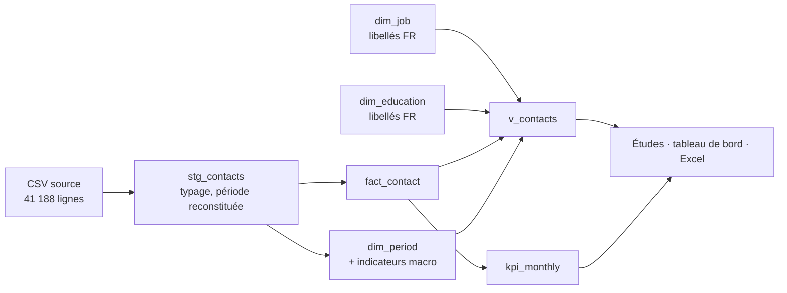

# Analyse des campagnes marketing d'une banque de détail

[](https://github.com/Adversitas/bank-marketing-analytics/actions/workflows/ci.yml)

**Tableau de bord en ligne → [adversitas.github.io/bank-marketing-analytics](https://adversitas.github.io/bank-marketing-analytics/)** · [Étude complète (notebook)](notebooks/etude_campagnes.ipynb) · [Catalogue des indicateurs](docs/catalogue_kpi.md)

Ce projet reproduit la chaîne de travail d'un data analyst au sein d'une direction marketing bancaire :

1. un **entrepôt SQL** (DuckDB, modèle en étoile) construit à partir des données brutes ;
2. un **catalogue d'indicateurs** défini une seule fois et réutilisé partout ;
3. des **études statistiques** sur le comportement des clients (intervalles de confiance, tests, régression) ;
4. un **score d'appétence** pour cibler la prochaine campagne ;
5. une **restitution diffusée automatiquement** : tableau de bord web republié chaque semaine, export Excel pour les équipes métier.

Les données sont réelles : 41 188 clients d'une banque portugaise contactés par téléphone entre mai 2008 et novembre 2010 pour souscrire un dépôt à terme ([UCI Bank Marketing](https://archive.ics.uci.edu/dataset/222/bank+marketing), Moro, Cortez & Rita, 2014, CC BY 4.0).

> **In English:** a marketing-analytics project on real retail-bank campaign data, covering a DuckDB star-schema warehouse in SQL, a single-source KPI catalogue, statistical studies (Wilson confidence intervals, chi-square tests with Cramér's V, logistic regression), a propensity score validated on a later time period, and a Plotly dashboard republished weekly to GitHub Pages alongside an Excel export. 22 tests run in CI.

## Principaux résultats

| Question | Constat | Recommandation |
|---|---|---|
| Comment la performance a-t-elle évolué ? | Le taux de souscription passe de **4,8 %** (2008, 27 690 clients) à **52,1 %** (2010, 2 058 clients). Le taux global de 11,3 % mélange deux régimes et ne décrit aucune période réelle. | Lire les indicateurs par période. |
| Le contexte de marché compte-t-il ? | Corrélation de rang **ρ = −0,70** entre l'Euribor 3 mois et le taux de souscription mensuel (26 mois). À profil égal, un Euribor < 2 % multiplie les chances de souscrire par 4,2. | Suivre l'Euribor dans le tableau de bord ; dimensionner les campagnes selon le contexte. |
| Qui souscrit ? | Les clients ayant déjà souscrit re-souscrivent à **65 %**, contre 9 % pour les clients jamais contactés. Les plus de 65 ans (47 %) et les moins de 25 ans (24 %) souscrivent nettement plus que les 35-54 ans (9 %). Le mobile convertit presque 3× mieux que le fixe. | Traiter les anciens souscripteurs en priorité ; privilégier le numéro mobile. |
| Faut-il limiter les relances ? | Rendements fortement décroissants. Un plafond de **5 appels** par client économise **15 % des appels** pour au plus **4 % des souscriptions**. | Plafond de 5 appels par client et par campagne, suivi par l'indicateur `PART_SURSOLLICITES`. |
| Peut-on mieux cibler ? | Score appris sur 2008-05 → 2009-05 et testé sur la période suivante : appeler les **30 % de clients les mieux scorés capte 55 % des souscriptions**, et le premier décile convertit **2,7×** mieux que la moyenne. | Cibler par score, en le recalibrant à chaque campagne. |

## Méthode

### Entrepôt SQL



- [`sql/01_staging.sql`](sql/01_staging.sql) : typage et renommage, et le code « 999 jours » de la source converti en NULL. Le fichier ne contient que le mois de contact, mais il est trié par date : **l'année est reconstituée** en détectant les retours en arrière du mois (fonction fenêtre `lag`). Un test vérifie que la période obtenue correspond à celle documentée (mai 2008 → novembre 2010).
- [`sql/02_model.sql`](sql/02_model.sql) : modèle en étoile, avec des dimensions portant les libellés français pour la restitution.
- [`sql/03_kpi_views.sql`](sql/03_kpi_views.sql) : vues d'indicateurs mensuels et vue analytique.

### Indicateurs

Les 10 indicateurs ([catalogue](docs/catalogue_kpi.md)) sont définis une seule fois dans [`kpis.py`](src/bankmkt/kpis.py). Chaque définition donne un nom, une définition métier, une formule, un sens de lecture et une expression SQL. Le tableau de bord, l'export Excel, la ligne de commande et la documentation lisent tous cette même définition. Les tests recalculent les principaux indicateurs en pandas pour vérifier le SQL.

Exemples : taux de souscription, appels par souscription (coût unitaire), pression commerciale, part de clients sur-sollicités, taux de re-souscription, part des contacts sur mobile.

### Rigueur statistique

- Chaque taux par segment est accompagné de son **intervalle de confiance de Wilson à 95 %**. Un segment n'est déclaré au-dessus ou en dessous de la moyenne que si l'intervalle exclut la moyenne.
- Sur 41 000 clients, presque toutes les associations sont « significatives ». Les variables sont donc classées par **taille d'effet (V de Cramér)**, pas par p-value.
- Une **régression logistique** sépare les effets qui se recoupent dans les taux bruts (âge et retraite, contexte de taux et changement de ciblage). Le sens de chaque odds ratio est vérifié par les tests.
- **Durée d'appel exclue du ciblage.** Elle prédit presque parfaitement la souscription, mais elle n'est connue qu'après l'appel. Un test garantit qu'elle n'entre jamais dans le modèle.
- **Validation temporelle du score** : apprentissage sur le passé, test sur le futur. Le taux de souscription passe de 6,4 % à 25,8 % entre les deux périodes, un test exigeant. Dans ce contexte, la régression logistique (AUC 0,72) fait mieux que le gradient boosting (0,71), plus sensible au changement de régime. Le modèle simple et interprétable est retenu.

### Restitution et diffusion

| Support | Contenu | Production |
|---|---|---|
| [Tableau de bord web](https://adversitas.github.io/bank-marketing-analytics/) | Tuiles d'indicateurs filtrables par année, évolution mensuelle, segments avec IC, pression commerciale, courbe de gains, facteurs de souscription, catalogue. Thèmes clair et sombre. | `bankmkt report`, publié par GitHub Actions **à chaque modification et chaque lundi** |
| Export Excel (`rapport_campagnes.xlsx`, [télécharger](https://adversitas.github.io/bank-marketing-analytics/rapport_campagnes.xlsx)) | 7 onglets mis en forme : synthèse, mensuel, segments, pression, ciblage, facteurs, catalogue | idem |
| [Notebook d'étude](notebooks/etude_campagnes.ipynb) | Analyse rédigée : qualité des données, questions, lecture des résultats, recommandations, limites | exécuté et versionné |
| `resultats.json` | Tous les chiffres, pour d'autres outils (Power BI, Tableau…) | idem |

## Utilisation

```bash
git clone https://github.com/Adversitas/bank-marketing-analytics.git
cd bank-marketing-analytics
python -m venv .venv && source .venv/bin/activate     # Windows : .venv\Scripts\activate
pip install -e ".[dev,notebook]"

bankmkt build                                  # entrepôt DuckDB : data/warehouse.duckdb
bankmkt kpi --par year                         # indicateurs par année
bankmkt kpi --par job_fr --where "year = 2008" # par profession, en 2008
bankmkt sql "SELECT period_label, taux_souscription FROM kpi_monthly"
bankmkt report                                 # site/index.html, site/rapport_campagnes.xlsx
pytest
```

```
$ bankmkt kpi --par year
| segment | Clients contactés | Souscriptions | Taux de souscription | Appels par souscription | Pression commerciale | ...
| 2008 | 27 690 | 1 339 | 4,8 % | 57,89 | 2,80 | ...
| 2009 | 11 440 | 2 228 | 19,5 % | 10,92 | 2,13 | ...
| 2010 | 2 058 | 1 073 | 52,1 % | 3,65 | 1,91 | ...
```

Pour réexécuter l'étude : `jupytext --to ipynb notebooks/etude_campagnes.py && jupyter nbconvert --execute --inplace --to notebook notebooks/etude_campagnes.ipynb`.

## Limites

- Les données proviennent d'une seule banque (Portugal, 2008-2010). Les ordres de grandeur ne sont pas transposables tels quels, mais la démarche l'est.
- La source ne contient pas d'identifiant client. Un même client ne peut donc pas être suivi d'une campagne à l'autre, et l'historique se limite aux variables « contacts précédents » et « résultat précédent ».
- Les résultats sont observationnels : l'effet d'un plafond d'appels ou d'un ciblage par score est estimé, pas mesuré. La prochaine étape serait un **test A/B** sur une campagne, avec un groupe témoin.
- La simulation du plafond d'appels donne une borne haute des pertes : elle suppose qu'un client qui a souscrit après le plafond n'aurait pas souscrit plus tôt.

## Organisation du dépôt

```
sql/                    staging, modèle en étoile, vues d'indicateurs
src/bankmkt/
  warehouse.py          construction de l'entrepôt DuckDB
  kpis.py               catalogue d'indicateurs (source unique)
  studies.py            segments + IC de Wilson, khi-deux / V de Cramér, pression, régression logistique
  targeting.py          score d'appétence, validation temporelle, gains et lift
  report.py             calcul unique des résultats pour tous les supports
  dashboard.py          tableau de bord HTML (Plotly)
  excel.py              export Excel mis en forme
  cli.py                ligne de commande `bankmkt`
notebooks/              étude rédigée (.py source + .ipynb exécuté)
docs/catalogue_kpi.md   catalogue généré
tests/                  22 tests (entrepôt, indicateurs, statistiques, ciblage, restitution)
data/raw/               données sources UCI (CC BY 4.0)
```

## Licence

Code : MIT. Données : [UCI Bank Marketing](https://archive.ics.uci.edu/dataset/222/bank+marketing), S. Moro, P. Cortez et P. Rita, *A Data-Driven Approach to Predict the Success of Bank Telemarketing*, Decision Support Systems, 2014. Licence CC BY 4.0.
